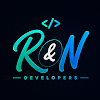
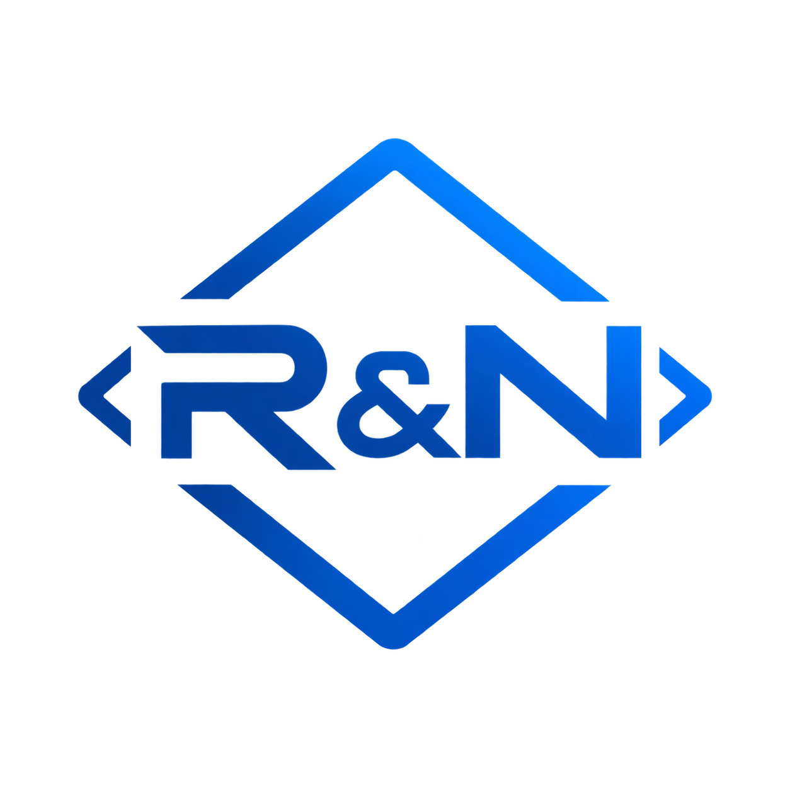
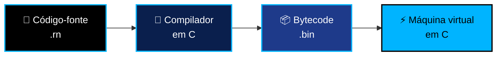

<div align="center">




<br />

<a href="https://github.com/rndevelopers-01/rndevelopers-01">
  
</a>

<br /><br />

[](https://wa.me/5521974614332)
[](https://www.youtube.com/@RNDevelopers-093)
[](https://instagram.com/rn.developers_)
[](mailto:rndevelopers093@gmail.com)

```js
const rn = ["sites", "apps", "scripts", "jogos"]
```

</div>


## 👥 &nbsp;Sobre nós

Somos a **R&N Developers**, uma equipe de dois jovens desenvolvedores criando **sites, aplicativos, scripts, jogos e soluções digitais sob medida**.

A R&N nasceu da vontade de transformar ideias em projetos reais. Somos dois adolescentes apaixonados por programação, tecnologia e criação de produtos digitais. Começamos criando nossos próprios projetos e hoje também desenvolvemos soluções para outras pessoas e empresas.

Nosso objetivo é simples: pegar uma ideia e transformar ela em algo que realmente possa ser usado. Ainda estamos construindo nossa história, e cada projeto novo faz parte dela.

> 💙 *"Dois desenvolvedores. Muitas ideias. Um projeto de cada vez."*

<div align="center">

| 👨‍💻 **2** | 🚀 **Projetos** | ⚡ **Tecnologia** |
|:---:|:---:|:---:|
| desenvolvedores | reais no ar | + criatividade |

</div>


## 🛠️ &nbsp;O que fazemos

<div align="center">

| 🌐 Sites | 📱 Aplicativos | ⚙️ Scripts | 🎮 Jogos | 🎯 Sob medida |
|:---:|:---:|:---:|:---:|:---:|
| Institucionais, landing pages, lojas e projetos personalizados | Desenvolvidos de acordo com a necessidade do projeto | Automatizações e scripts personalizados | Jogos e experiências interativas | Projetos de acordo com a ideia do cliente |

</div>


## 💻 &nbsp;O que sabemos usar

Nosso ranking, do que mais sabemos pro que ainda estamos aprendendo. **Nosso foco é Python.**

<div align="center">


<table>
  <tr>
    <td align="center" width="130"><br /><b>Python</b></td>
    <td align="center" width="130"><br /><b>R&amp;N</b></td>
  </tr>
</table>


<table>
  <tr>
    <td align="center" width="130"><br /><b>HTML</b></td>
    <td align="center" width="130"><br /><b>CSS</b></td>
    <td align="center" width="130"><br /><b>JavaScript</b></td>
    <td align="center" width="130"><br /><b>TypeScript</b></td>
  </tr>
</table>


<table>
  <tr>
    <td align="center" width="130"><br /><b>Java</b></td>
    <td align="center" width="130"><br /><b>SQL</b></td>
  </tr>
</table>


<table>
  <tr>
    <td align="center" width="130"><br /><b>C#</b></td>
    <td align="center" width="130"><br /><b>C++</b></td>
    <td align="center" width="130"><br /><b>PHP</b></td>
  </tr>
  <tr>
    <td align="center" width="130"><br /><b>Ruby</b></td>
    <td align="center" width="130"><br /><b>Lua</b></td>
    <td align="center" width="130"><br /><b>PowerShell</b></td>
  </tr>
  <tr>
    <td align="center" width="130"><br /><b>Assembly</b></td>
    <td align="center" width="130"><br /><b>Arduino</b></td>
    <td align="center" width="130"><br /><b>Rust</b></td>
    <td align="center" width="130"><br /><b>Dart</b></td>
  </tr>
</table>

</div>

### 🧰 Frameworks e ferramentas

<div align="center">

<table>
  <tr>
    <td align="center" width="130"><br /><b>React</b></td>
    <td align="center" width="130"><br /><b>Tailwind</b></td>
    <td align="center" width="130"><br /><b>Flutter</b></td>
    <td align="center" width="130"><br /><b>Node.js</b></td>
  </tr>
  <tr>
    <td align="center" width="130"><br /><b>Express.js</b></td>
    <td align="center" width="130"><br /><b>Git</b></td>
  </tr>
</table>

</div>


## 🚀 &nbsp;Projetos

Alguns projetos que fazem parte da nossa caminhada.

### 👕 [JM Multimarcas](https://jmmultimarcas.site/)

Site desenvolvido para a JM Multimarcas, uma loja de camisas de time no atacado e varejo. Qualidade premium para todo o Brasil.


[](https://jmmultimarcas.site/)

### ✈️ [Fui Lá Viagens](https://fuilaviagens.com/)

Site desenvolvido para uma agência de viagens especializada em pacotes turísticos e excursões. CADASTUR: 56.002.390/0001-93.


[](https://fuilaviagens.com/)

### ⭕ [Jogo da Velha](https://inerciamc.fun/)

O jogo da velha clássico transformado em algo nosso: simples, divertido e pronto pra baixar. Feito com **Flutter**, roda no **Android** e no **PC**.


[](https://inerciamc.fun/)


## 🇧🇷 &nbsp;Linguagem R&N

<div align="center">


**Uma linguagem criada por nós. Programação 100% em português brasileiro.**


</div>

A R&N é uma linguagem de programação independente, desenvolvida para tornar a programação mais acessível para quem fala português. Você escreve código usando palavras familiares, com uma sintaxe própria e um sistema desenvolvido especialmente para a linguagem.

### ⚙️ Do código à execução



| Etapa | Componente | O que faz |
|:---:|---|---|
| **01** | **Código-fonte `.rn`** | É onde você escreve seus programas. |
| **02** | **Compilador em C** | Analisa as instruções reconhecidas e gera o código compilado. |
| **03** | **Bytecode `.bin`** | Representa as instruções em formato binário. |
| **04** | **Máquina virtual em C** | Interpreta o bytecode e executa as operações suportadas. |

> 💙 A R&N não é simplesmente um conjunto de comandos que traduz o código para Python. Ela possui uma estrutura própria de compilação e execução.

### 💬 O código fala português

Em vez de `print()` ou `console.log()`, a R&N utiliza instruções como `mostrar()`, `entrada()` e `inteiro()`.

**hello.rn**
```
mostrar("Hello World!")
```

**Mostrar mensagens**
```
mostrar("Olá, mundo!")
mostrar("Bem-vindo à R&N!")
```

**Receber informações**
```
nome = entrada("Qual é o seu nome? ")
mostrar("Olá", nome)
```

**Trabalhar com números inteiros**
```
idade = inteiro(entrada("Qual é a sua idade? "))
mostrar("Sua idade:", idade)
```

**Criar variáveis**
```
nome = "R&N"
mensagem = "Olá, mundo!"
mostrar(nome, mensagem)
```

**Tomar decisões**
```
idade = inteiro(entrada("Digite sua idade: "))

se idade >= 18:
    mostrar("Maior de idade")
senao:
    mostrar("Menor de idade")
```

> ℹ️ A sintaxe ilustrada apresenta a proposta da linguagem. O funcionamento de cada operador e bloco deve ser validado na versão atual do compilador.

### 🔌 Integrações especiais

**📱 QR Code: transforme informações em imagens**

A R&N possui componentes voltados à geração e ao salvamento de QR Codes, permitindo que programas criados na linguagem gerem códigos escaneáveis por celulares e outros dispositivos compatíveis.

- Criar QR Codes com informações de um projeto.
- Salvar o QR Code gerado como imagem PNG.
- Utilizar códigos em ferramentas e aplicações desenvolvidas com a R&N.

> A disponibilidade da funcionalidade depende da versão atual do compilador e da máquina virtual.

**🎲 Sorteios: ideias para projetos interativos**

Uma possibilidade de aplicação para projetos que precisam escolher participantes ou selecionar um resultado aleatoriamente.

- Sorteio de nomes e participantes.
- Seleção aleatória de um ganhador.
- Ferramentas para eventos e comunidades.
- Projetos que combinem participantes e QR Codes para facilitar a identificação.

> Considere os sorteios uma possibilidade de expansão até que os comandos de aleatoriedade e o fluxo completo estejam implementados e testados.

### 🔭 O que vem por aí

- ➕ Mais operações matemáticas e lógicas
- 📚 Listas e estruturas de dados
- 🧩 Funções criadas pelo programador
- 📁 Recursos para arquivos e automação
- 🛠️ Ferramentas para facilitar o desenvolvimento e a execução de projetos

> Esses itens representam objetivos de evolução, não uma garantia de que todos já estejam disponíveis.

<div align="center">

**R&N: nossas ideias, nossa linguagem, nosso código.**

</div>


## 📊 &nbsp;Nossa evolução

Além de desenvolver projetos, também compartilhamos um pouco da nossa caminhada, experiências e coisas que estamos aprendendo.

<div align="center">


<br /><br />

[](https://github.com/rndevelopers-01)
[](https://www.youtube.com/@RNDevelopers-093)

</div>


## 📬 &nbsp;Vamos conversar?

<div align="center">

**Tem uma ideia? Vamos transformar ela em projeto.**

[](https://wa.me/5521974614332)
[](mailto:rndevelopers093@gmail.com)
[](https://instagram.com/rn.developers_)

<br />


*© 2026 R&N Developers. Todos os direitos reservados.*

</div>
